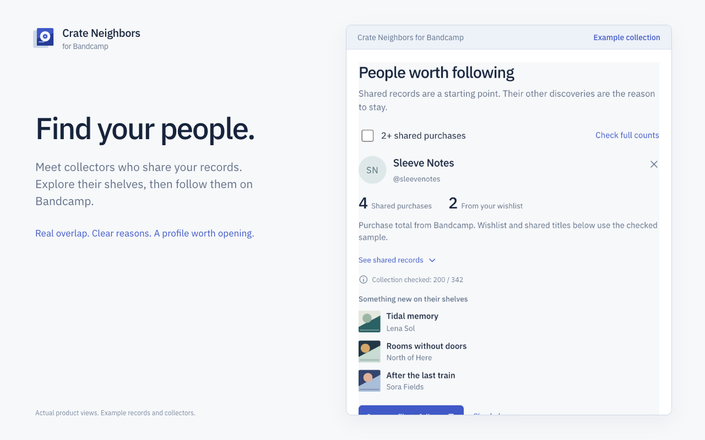

# Crate Neighbors for Bandcamp

**Discover new music on Bandcamp through people with similar collections.**

Crate Neighbors for Bandcamp is a free Chrome extension that compares your purchases and wishlist with public collectors. Find people worth following, explore records you do not own, and see why each discovery was suggested.

[Download the latest release](https://github.com/skitniknikita/bandcamp-crate-neighbors/releases/latest) · [Website](https://skitniknikita.github.io/bandcamp-crate-neighbors/) · [Privacy](https://skitniknikita.github.io/bandcamp-crate-neighbors/privacy.html) · [Support](https://github.com/skitniknikita/bandcamp-crate-neighbors/issues)



*Screens show isolated example collections, not a user's account.*

## What it does

- **Find collectors with shared purchases.** Start from releases you like, compare their supporters, and open interesting profiles to follow them.
- **Discover music beyond your wishlist.** See records from matching collections, excluding releases already in your purchases or wishlist.
- **Understand the evidence.** Inspect shared releases, the amount of each collection checked, and the full shared-purchase count when Bandcamp provides it for your signed-in account.
- **Keep digging at your pace.** Pause and resume a saved queue, check deeper, hide unwanted results, and filter for two or more shared purchases.
- **Keep your music data local.** No subscription, extension account, analytics, or developer backend. Processing and result storage happen in your browser.

Requires Chrome 120 or newer. English and Russian interfaces are included.

## Install in Chrome

1. Open [Releases](https://github.com/skitniknikita/bandcamp-crate-neighbors/releases/latest) and download **bandcamp-crate-neighbors-0.1.1.zip**.
2. Unzip it into a permanent folder.
3. Open `chrome://extensions`, enable **Developer mode**, and choose **Load unpacked**.
4. Select the folder directly containing `manifest.json`. Pin and click the extension icon to open its side panel.

Keep the unpacked folder in place. The Chrome Web Store listing is not available yet; this release is installed from a folder.

To build from source instead, use the development commands below, then load `dist` in Chrome.

## First search

1. Open Bandcamp in the same Chrome profile. Identify your account from the open page, or paste a fan-profile URL.
2. Let your purchases, wishlist, and followed collectors load.
3. Review the starting records, choose others, or add the album currently open.
4. Start a search. Explore **Collectors** and **Music** as results arrive.
5. Open Bandcamp to listen, buy a release, or follow a collector. These actions are always yours.

A search examines supporters of selected records, not every Bandcamp account. The first pass checks recent purchases; deeper checks load more. Music and collector lists display in batches of 20.

**Full totals and samples are different.** A full shared-purchase count is used only when the signed-in Bandcamp account matches the connected profile. Shared titles and wishlist matches still refer to the examined sample. Without a trusted full count, `≥ 1` means “at least one found”, not “only one in common”. **Check full counts** preserves the collection data already loaded.

## Privacy and limits

The extension sends requests to Bandcamp and loads artwork from its CDN. It uses the browser's existing session without requesting your password or storing authentication cookies or tokens. Only necessary profile and release metadata, results, queue state, hidden items, and settings are stored locally.

Version 0.1.1 supports `bandcamp.com` and its subdomains. Shops on separate custom domains are not supported. Private, removed, or unavailable data may be skipped. Scans respect server cooldowns and stop for browser checks or access problems. There are no paid daily limits.

This is an independent project, not affiliated with or endorsed by Bandcamp.

Read the [privacy policy](https://skitniknikita.github.io/bandcamp-crate-neighbors/privacy.html) or [get support](SUPPORT.md).

## Development

Requires Node.js 22.12 or newer.

```sh
npm ci
npm run typecheck
npm test
npm run build
```

Load `dist` as an unpacked extension. The build also creates `artifacts/bandcamp-crate-neighbors-0.1.1.zip` and a package report. These generated files are not part of the source checkout.

```sh
npx playwright install chromium
npm run test:browser
node scripts/browser-test.mjs --live
```

Browser tests use an isolated temporary Chromium profile. Fixture tests cover comparisons, pagination, account isolation, persistence, cooldowns, and UI behavior. The optional live check reads public data and pauses a large sync. Neither test reads your personal Chrome profile.

`npm run dev` previews the interface with clearly marked example data. Installed builds use real Bandcamp data.

Store materials: [listing](docs/store-listing.md), [data disclosures](docs/data-handling-disclosures.md), [release checklist](docs/release-checklist.md).

## По-русски

**Crate Neighbors for Bandcamp** — бесплатное расширение Chrome для поиска новой музыки и коллекционеров с похожим вкусом. Учитывает покупки и wishlist, показывает причины рекомендаций и хранит результаты в браузере.

Скачайте ZIP из [последнего выпуска](https://github.com/skitniknikita/bandcamp-crate-neighbors/releases/latest), распакуйте его и загрузите папку через `chrome://extensions` → «Режим разработчика» → «Загрузить распакованное расширение». Нужен Chrome 120 или новее.

Подключите профиль, дождитесь загрузки коллекции, выберите стартовые релизы и начните поиск. Фильтр «От 2 общих покупок» помогает найти людей с несколькими подтверждёнными совпадениями. Полный счётчик Bandcamp доступен при входе именно в подключённый аккаунт; иначе показывается нижняя граница из проверенной выборки.

[Подробнее по-русски](https://skitniknikita.github.io/bandcamp-crate-neighbors/ru.html) · [Приватность](https://skitniknikita.github.io/bandcamp-crate-neighbors/privacy.html#ru) · [Поддержка](https://github.com/skitniknikita/bandcamp-crate-neighbors/issues)

Search-engine sitemap: [sitemap.xml](https://skitniknikita.github.io/bandcamp-crate-neighbors/sitemap.xml). Search indexing and rankings are not guaranteed.
